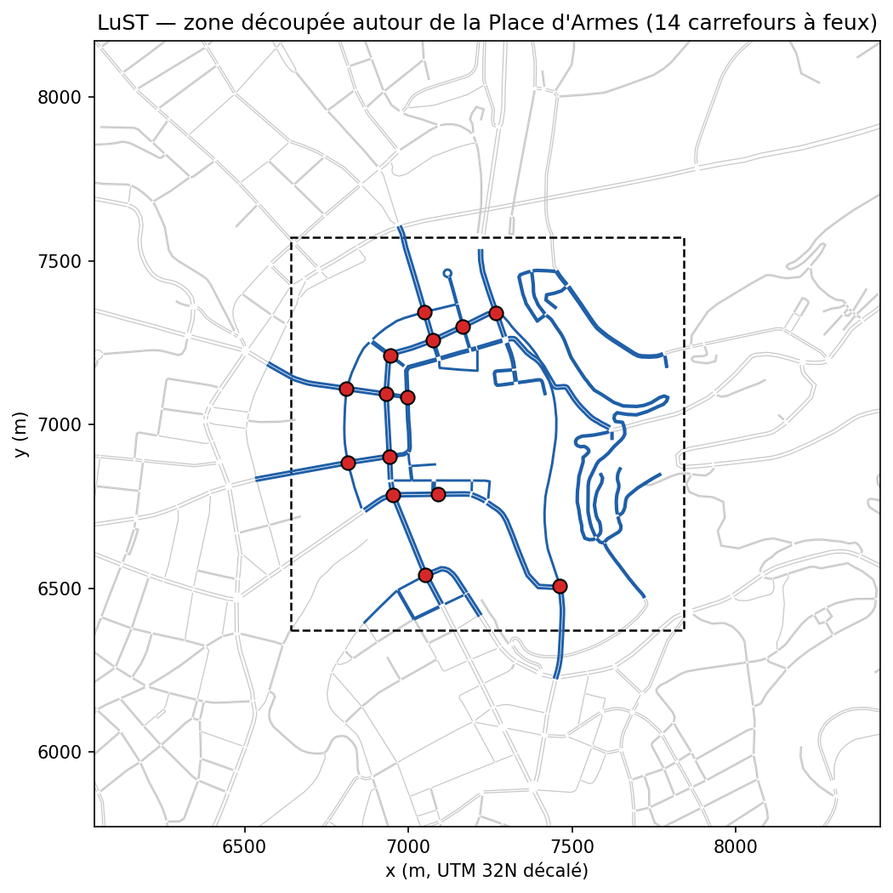

# Scénarios de simulation

Ce document décrit les réseaux routiers et la demande de trafic utilisés dans toutes les
expériences, ainsi que la procédure qui permet de les régénérer à l'identique.

Tous les fichiers SUMO (`.net.xml`, `.rou.xml`, …) sont **générés par script** à partir des
fichiers de configuration `configs/scenarios/*.yaml` ; ils ne sont pas versionnés.

```bash
networks/build_all.sh                               # construit puis valide tous les scénarios
python -m trafficmarl scenarios build grid3x3       # un seul scénario
python -m trafficmarl scenarios validate all        # rapport : results/scenario_validation/
```

Chaque scénario construit contient un fichier `manifest.yaml` qui liste le réseau, les fichiers
de routes par profil de demande et par split (entraînement / évaluation), ainsi que les
identifiants des feux. Le reste du code lit uniquement ce manifeste.

## 1. Vue d'ensemble

| Scénario | Carrefours à feux | Réseau | Rôle |
|---|---|---|---|
| `single` | 1 | carrefour isolé à 4 branches | vérification que l'apprentissage fonctionne |
| `corridor` | 4 | artère est-ouest, 4 carrefours | coordination en « onde verte » |
| `grid3x3` | 9 | grille 3 × 3 | scénario principal de développement |
| `grid5x5` | 25 | grille 5 × 5 (type Manhattan) | passage à l'échelle |
| `lust` | 14 | centre-ville de Luxembourg (LuST) | scénario urbain réaliste |

## 2. Réseaux synthétiques (`single`, `corridor`, `grid3x3`, `grid5x5`)

Générés avec `netgenerate` (paramètres dans `configs/scenarios/_synthetic_defaults.yaml`) :

- îlots de **200 m** entre carrefours, branches d'accès de 200 m en bordure ;
- **2 voies** par approche + **une voie dédiée au tourne-à-gauche** de 100 m ;
- vitesse limite **50 km/h** ;
- feux **à plan fixe** générés par SUMO, cycle de **90 s**, avec **4 phases vertes**
  (Nord-Sud tout droit/droite, Nord-Sud gauche protégé, Est-Ouest tout droit/droite,
  Est-Ouest gauche protégé) séparées par des phases jaunes de 3 s.

La voie de tourne-à-gauche dédiée a été choisie pour obtenir l'espace d'actions standard à
4 phases utilisé dans la littérature (SUMO-RL, RESCO). Sans elle, SUMO ne génère que 2 phases
avec tourne-à-gauche permissif, ce qui laisse très peu de marge de décision aux agents.

Ce plan fixe généré par SUMO constitue la ligne de base « programme SUMO par défaut ».

## 3. Demande de trafic synthétique

Implémentation : `src/trafficmarl/scenarios/demand.py`.

- **Arrivées** : processus de Poisson indépendant sur chaque entrée en bordure du réseau. Le
  débit peut varier dans le temps (processus non homogène simulé par amincissement,
  Lewis & Shedler 1979).
- **Itinéraires** : à chaque carrefour, le véhicule va tout droit avec une probabilité de 0,70,
  tourne à droite avec 0,15 et à gauche avec 0,15, jusqu'à quitter le réseau. Nous n'avons pas
  utilisé de paires origine-destination uniformes : sur un carrefour à 4 branches, un tiers
  des véhicules tournerait alors à gauche et saturerait les voies de tourne-à-gauche bien avant
  les voies principales.
- **Corridor** : les deux extrémités de l'artère reçoivent un débit 3 fois supérieur à celui
  des rues transversales, pour qu'une onde verte soit réellement utile.
- **Profils de demande** : multiplicateurs appliqués au débit de base `entry_rate` :

| Profil | Multiplicateur |
|---|---|
| `low` | 0,5 |
| `medium` | 1,0 |
| `high` | 1,5 |
| `peak` | 0,5 → 1,0 → 1,7 → 1,7 → 1,0 → 0,5 (interpolation linéaire sur 1 h) |

  Le profil `peak` reproduit une heure de pointe non stationnaire qui dépasse brièvement le
  niveau `high`.
- **Séparation entraînement / évaluation** : 3 fichiers de routes d'entraînement (graines
  1001-1003) et 2 fichiers d'évaluation (graines 2001-2002) par profil. Une graine distincte est
  dérivée pour chaque couple (graine, profil). Les politiques ne sont donc jamais évaluées sur un
  trafic vu pendant l'entraînement.
- Chaque fichier contient **1 h d'insertions** de véhicules.

### Calibration du débit de base

Le débit de base de chaque réseau a été choisi pour que le profil `high` se situe **juste sous
la saturation** du plan fixe par défaut. Ainsi :

- `low` est fluide, `medium` modérément chargé et `high` proche de la saturation ;
- le profil `peak` sature brièvement le réseau, sans blocage généralisé (*gridlock*).

Le balayage se reproduit avec `networks/calibrate_demand.py`. Temps d'attente moyen (s) sous plan
fixe, demande constante, graine 7 :

| Débit par entrée (véh/h) | single | corridor | grid3x3 | grid5x5 |
|---|---|---|---|---|
| 300 | – | 33 | – | – |
| 450 | – | 47 | 45 | 73 |
| 550 | – | 71 | – | – |
| 600 | 19 | – | 47 | 75 |
| 650 | – | 75 | – | – |
| 750 | – | – | 50 | 81 |
| 900 | 20 | – | 57 | 93 |
| 1100 | – | – | 107 | 153 |
| 1200 | 32 | – | – | – |
| 1300 | – | – | 165 | 254 |
| 1400 | 75 | – | – | – |
| 1500 | – | – | 191 (2 téléportations) | – |
| 1600 | 84 | – | – | – |
| 1700 | – | – | 205 (16 téléportations) | – |

Débits retenus (`medium`) : `single` 800, `corridor` 320 (×3 sur l'artère), `grid3x3` 650,
`grid5x5` 600 véh/h par entrée.

## 4. Scénario réaliste : LuST découpé

Source : *Luxembourg SUMO Traffic (LuST) Scenario*, L. Codeca et al., IEEE ITS Magazine, 2017
(licence MIT), cloné dans `external/LuSTScenario`. Le réseau complet (≈ 200 feux, 24 h de trafic)
est trop lourd pour l'apprentissage ; nous en extrayons le centre-ville.

Procédure (`networks/lust/crop_lust.py`, paramètres dans `configs/scenarios/lust.yaml`) :

1. **Sélection** des feux dont le centre se trouve dans un carré de 1,2 km × 1,2 km centré sur
   la **Place d'Armes** (49,6113 N ; 6,1302 E) : 18 feux.
2. **Découpe** avec `netconvert`. Nous conservons toutes les routes accessibles aux voitures
   situées dans le carré, ainsi que toutes les approches des carrefours sélectionnés, afin que
   leurs plans de feux restent valides. Les 4 feux situés en bordure, dont certaines approches
   sont coupées, deviennent des carrefours sans feux. Seule la plus grande composante connexe
   est gardée. Un groupe de 4 feux, relié au reste uniquement par l'extérieur du carré, est
   ainsi écarté : **il reste 14 carrefours à feux et 149 tronçons**.
3. **Plans de feux** : nous gardons les plans fixes de LuST (`tll.static.xml`) dans le réseau, ce
   qui donne la ligne de base « plan fixe ». Les plans actionnés d'origine de LuST sont placés
   dans un fichier séparé (`tls_actuated.add.xml`) pour la ligne de base « actionnée ». Garder
   les deux plans dans le réseau fait planter SUMO avec SUMO-RL, qui réécrit le premier plan de
   chaque feu (le plan actionné) alors que le plan fixe est actif.
4. **Routes** : les itinéraires LuST sont découpés avec l'outil SUMO `cutRoutes.py`. Celui-ci
   recale l'heure de départ de chaque véhicule sur son entrée dans la zone. Nous utilisons les
   routes à **équilibre dynamique (DUE)** calculées par LuST pour les plans fixes, plus le trafic
   de transit. Les lignes de bus ne sont pas incluses.
5. **Fenêtres horaires** (pointe du matin) : entraînement **07:00-08:00**, évaluation
   **08:00-09:00**. Les véhicules sont disjoints et chaque fenêtre est ramenée à t = 0.
6. **Profils** : la demande réelle est mise à l'échelle par tirage aléatoire avec graine fixe
   (suppression ou duplication de véhicules) : `low` ×0,6, `medium` ×1,0, `high` ×1,3, `peak`
   0,6 → 1,5 → 0,6 sur l'heure.

**Pourquoi DUE plutôt que DUA ?** Nous avons d'abord essayé les routes DUA (plus court chemin)
de LuST. Avec elles, tous les conducteurs empruntent le même boulevard, et la zone découpée se
bloque même à 60 % de la demande : attente moyenne supérieure à 280 s et téléportations, avec
les plans fixes comme avec les plans actionnés. Les routes DUE répartissent le trafic de façon
réaliste.



*Figure : réseau LuST autour de la zone découpée (gris), tronçons conservés (bleu), carrefours à
feux contrôlés par les agents (rouge), carré de sélection (pointillés).*

Les carrefours LuST sont hétérogènes : de 2 à 4 phases vertes, et des observations de taille 15
à 29 avec les observations par défaut de SUMO-RL. L'environnement (phase 2) utilisera donc du
remplissage par zéros (*padding*), un masquage des actions invalides et un identifiant de
carrefour dans l'observation.

## 5. Validation

Critère d'acceptation : chaque fichier de routes est simulé sans interface graphique avec les
plans par défaut, jusqu'à ce que tous les véhicules aient quitté le réseau (plafond 7 200 s).
SUMO ne doit signaler aucune erreur. La proportion de véhicules téléportés (le signe d'un blocage
dans SUMO, après 300 s d'immobilité) doit rester **≤ 1 %**. Enfin, tous les véhicules doivent
être insérés et arrivés.

Résultats (moyenne sur les fichiers de chaque profil, entraînement et évaluation) :

| Scénario | Profil | Fichiers validés | Véhicules (moy.) | Attente moy. (s) | Durée trajet moy. (s) | Téléportations max |
|---|---|---|---|---|---|---|
| `single` | low | 5/5 | 1580 | 16,8 | 53,3 | 0,00 % |
| `single` | medium | 5/5 | 3199 | 20,0 | 58,0 | 0,00 % |
| `single` | high | 5/5 | 4804 | 45,4 | 93,1 | 0,00 % |
| `single` | peak | 5/5 | 3843 | 44,3 | 91,3 | 0,00 % |
| `corridor` | low | 5/5 | 2259 | 28,8 | 81,2 | 0,00 % |
| `corridor` | medium | 5/5 | 4489 | 32,8 | 86,9 | 0,00 % |
| `corridor` | high | 5/5 | 6767 | 63,5 | 127,6 | 0,00 % |
| `corridor` | peak | 5/5 | 5280 | 53,9 | 114,7 | 0,00 % |
| `grid3x3` | low | 5/5 | 3894 | 43,1 | 117,6 | 0,00 % |
| `grid3x3` | medium | 5/5 | 7850 | 47,7 | 124,6 | 0,00 % |
| `grid3x3` | high | 5/5 | 11575 | 63,5 | 145,6 | 0,00 % |
| `grid3x3` | peak | 5/5 | 9201 | 65,8 | 148,7 | 0,00 % |
| `grid5x5` | low | 5/5 | 6028 | 70,2 | 182,9 | 0,00 % |
| `grid5x5` | medium | 5/5 | 12034 | 76,0 | 191,7 | 0,00 % |
| `grid5x5` | high | 5/5 | 17963 | 92,5 | 214,0 | 0,00 % |
| `grid5x5` | peak | 5/5 | 14173 | 92,1 | 213,1 | 0,00 % |
| `lust` | low | 2/2 | 2594 | 27,6 | 116,8 | 0,00 % |
| `lust` | medium | 2/2 | 4349 | 36,8 | 134,8 | 0,00 % |
| `lust` | high | 2/2 | 5676 | 110,7 | 265,0 | 0,10 % |
| `lust` | peak | 2/2 | 4900 | 83,7 | 227,7 | 0,11 % |

Total : 88/88 fichiers de routes validés.
